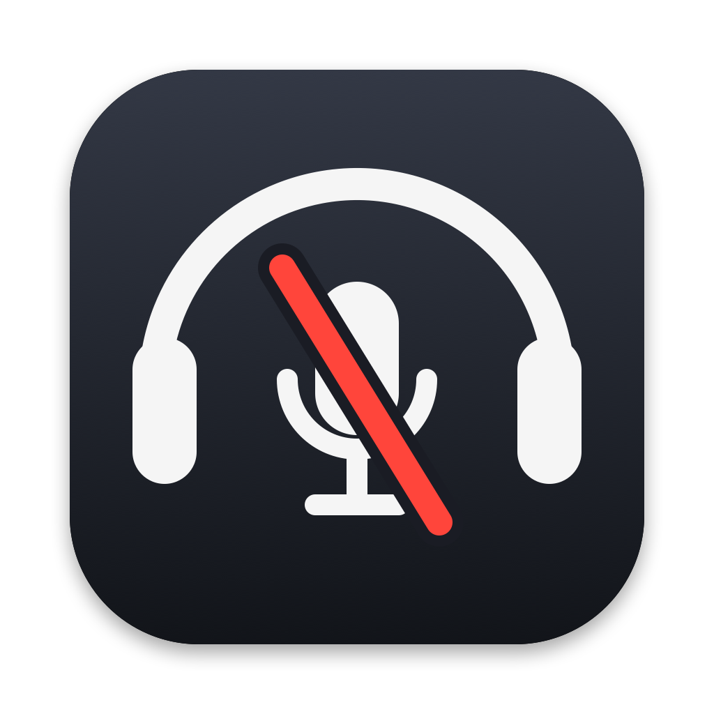
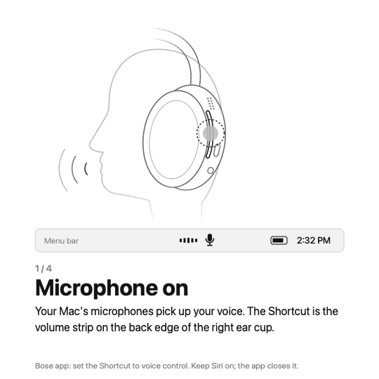

<p align="center">
  
</p>

<h1 align="center">Bose-Mute-Microphone</h1>

A native macOS menu bar app (Swift, AppKit, Core Audio) that mutes every microphone on the Mac at once, from the Shortcut gesture of the **Bose QuietComfort Ultra Headphones (2nd Gen)**, from a keyboard shortcut, or from the menu.

- Shows a clear menu bar indicator and plays different sounds for mute and unmute.
- Checks the value each driver actually applied.
- Restores the exact previous state.
- Starts with the Mac.

Tested on macOS 26.5.1 with QC Ultra 2 firmware 10.12.12. The full investigation, with log evidence, is in [docs/DIAGNOSTICO.md](docs/DIAGNOSTICO.md).

## Quick start

```sh
./scripts/install.sh
```

This builds the app, copies it to `~/Applications/Bose-Mute-Microphone.app` and launches it. On first launch the app registers itself as a Login Item.

Then set up the headset and the Mac:

1. **Bose app** (phone): set **Shortcut** to **voice control** (Use your device voice control).
2. **macOS**: keep **Siri turned on** (System Settings › Apple Intelligence & Siri). See [why](#why-siri-must-stay-on).
3. Touch and hold the volume strip (the Shortcut) to mute. Do it again to unmute.

## Using it

<p align="center">
  
</p>

Still slides: [1](docs/images/tutorial/slide-1.png) · [2](docs/images/tutorial/slide-2.png) · [3](docs/images/tutorial/slide-3.png) · [4](docs/images/tutorial/slide-4.png). They are drawn by `scripts/make-tutorial.swift`; run it with `slides` or `gif`. The hand was generated once with Gemini "Nano Banana 2" (`gemini-3.1-flash-image`) as line art and is stored in `docs/images/tutorial/assets/hand-source.png`. The script makes its background transparent; everything else is drawn in code.

| Trigger | How |
|---|---|
| Bose Shortcut | touch and hold the volume strip (~2 s) |
| Keyboard | `⌃⌥⌘M` (works anywhere, no permission needed) |
| Menu | click the menu bar icon › *Silenciar todos os microfones* / *Reativar microfones* |

Each trigger toggles: the first one mutes every input device, and the next restores the exact values from before. A mic that was already muted stays muted.

### Indicator and sounds

| Menu bar | Meaning |
|---|---|
| microphone (template) | microphones active |
| red slashed microphone + **MUTE** | every present input device verified muted |
| orange ⚠︎ + **MUTE?** | muted mode on, but at least one device could not be verified muted |

- **Mute**: a descending two-tone cue.
- **Unmute**: an ascending cue.
- Both are synthesized in memory and played on the default output, which is the headset when it is the output. Nothing is recorded.

### Menu

| Item | What it does |
|---|---|
| status line | Microfones ativos / MUTADOS (n/n verificados) / PARCIAL |
| Silenciar todos os microfones / Reativar microfones (`⌃⌥⌘M`) | toggle |
| Dispositivos de entrada | each input device: default, in use, and the per-device result (mute verified, volume 0 verified, NÃO suportado, FALHOU) |
| Ignorar dispositivos › | leave a device out (e.g. a virtual loopback that ignores mute). If the app had muted it, it is restored immediately |
| Usar atalho do Bose | turn the Bose trigger on/off, plus monitor state and last event time/address |
| Iniciar com o Mac | Login Item on/off (`SMAppService`) |
| Abrir ajustes da Siri… | opens System Settings; the app never changes Siri settings itself |
| Fechar a Siri aberta pelo atalho do Bose | on by default; see [below](#why-siri-must-stay-on) |
| Sons de mute/unmute | cues on/off |
| Abrir log de diagnóstico | opens `~/Library/Logs/Bose-Mute-Microphone.log` |
| Sair (restaura microfones) | quits and restores the previous state |

## How it works

### Muting (Core Audio)

- **Writes**: for each input device the app writes `kAudioDevicePropertyMute = 1` (input scope). When a device has no usable mute control, it sets every settable input volume element to 0 instead.
- **Read-back**: every write is read back from the driver for up to 300 ms. A device counts as muted only when the driver reports it.
  - Devices that accept the write but keep the old value are reported as **FALHOU**.
  - Devices without writable controls are reported as **NÃO suportado**.
  - Neither kind is ever shown as muted.
- **While muted**:
  - devices that appear or reconnect are muted too;
  - mute is re-applied if something else turns it off;
  - Core Audio property listeners drive this, plus a 2 s check as a safety net.
- **Unmute** restores the original mute and volume values per device and verifies them. For 20 s afterwards it keeps watching and restores again if the driver changes a value.
  - Why: a Bose Shortcut press opens and closes an HFP/SCO link for Siri. The Bluetooth driver was seen setting the headset mic back to mute = 1 after a verified restore.
- **Persistence**: pre-mute values are saved in `~/Library/Application Support/Bose-Mute-Microphone/mute-snapshot.json`. If the app crashes while muted, the next launch resumes muted mode and can restore. Quitting always restores.
- **No automatic muting.** The app never mutes at launch.

### The Bose Shortcut

The Shortcut is **not** a HID key or a media command. With *voice control* selected, the headset sends the HFP **voice-recognition request (`AT+BVRA`)**. macOS's `bluetoothd` owns the HFP link and passes the request to Siri. No public API lets a third-party app receive or intercept it.

The app **watches** the `bluetoothd` unified-log line that records it, through `/usr/bin/log stream` with a predicate on `category == "Server.Handsfree"`:

```
[com.apple.bluetooth:Server.Handsfree] Received voice recognition event from device AA:BB:CC:11:22:33
```

- **One press, one toggle.** bluetoothd logs a second line ("Received 'start voice command' event…") for the same press, and it is ignored.
- **Debounce**: 1.5 s, measured from the time the log data arrives.
- **Strict parsing.** A full Bluetooth address must follow the marker. The `log stream` header contains the marker text itself and once caused a false toggle.

### Why Siri must stay on

Every Shortcut press makes macOS start Siri, and that cannot be blocked from an app. The headset then waits for that voice session to end.

| Siri | Result |
|---|---|
| **off** | nobody answers the request. The headset sends **one** press and then ignores the Shortcut until it reconnects (seen 3 times) |
| on, app does nothing | works on every press, but Siri opens and listens each time |
| **on + "Fechar a Siri aberta pelo atalho do Bose"** (default) | works on every press. Siri flashes for about 1 s |

How the third row works:

1. After a Bose press, the app waits for the SCO link Siri opens ("Making sco connection for playing voice-command"), or 1.5 s at most.
2. It asks Siri to quit (`NSRunningApplication.terminate`). It force-quits only if Siri ignores that.
3. bluetoothd closes the voice link ("Voice command was active, sco will be closed"). This ends the session on the headset, which is then ready for the next press.
4. macOS relaunches Siri on demand.

Only Bose presses trigger this; Siri started any other way is left alone.

Tested: four presses in a row toggled mute → unmute → mute → unmute, and Siri quit cleanly each time.

### Start with the Mac

On first launch the app calls `SMAppService.mainApp.register()`. It then appears in System Settings › General › Login Items, and the menu checkbox toggles it. A user who turns it off stays off.

## Limitations

- **The mute happens in the macOS driver, not in the headset.** The headset microphone itself stays on; the QC Ultra 2 has no mic-mute control (Bose support confirms this). An app that reads the device below the HAL controls could still capture audio.
- **Some devices ignore mute.** `Microsoft Teams Audio`, a virtual loopback, accepts the write (`noErr`) but never changes the value. It shows **FALHOU** and the icon shows **MUTE?** until you put it in *Ignorar dispositivos*.
- **The Bose trigger depends on log text.** It is not a stable API and may change with macOS updates. If it breaks, `⌃⌥⌘M` and the menu keep working.
- **Side effects of a Bose press**: Siri flashes for about 1 s, and the headset audio switches to call quality (HFP) for about 1 s.
- **Multipoint.** When the headset is also connected to a phone, it can send the voice request to the phone instead. This was seen while the phone's HFP link reconnected.
- **During a call**, the headset does not offer voice control (Bose guide p.19), so use `⌃⌥⌘M` or the menu.
- **Other buttons are not used.** The Multi-function button's play/pause/next/previous (AVRCP) stay as media controls on purpose. Capture during Shortcut presses saw no media-key or HID event from the headset.
- **No drivers, no SIP changes, no extra permissions.** The app needs no Microphone or Accessibility access.

## Project layout

```
Package.swift
Sources/
  BoseMuteCore/            logic, testable without hardware
    AudioBackend.swift       device/control types + backend protocol
    CoreAudioBackend.swift   real backend (HAL properties, listeners)
    FilteringBackend.swift   hides ignored devices / single-device self-test
    MuteController.swift     mute, verify, restore, enforce, restore watch
    BoseButtonMonitor.swift  bluetoothd log stream → Bose press events
    SnapshotStore.swift      crash-safe pre-mute snapshot
    ToneGenerator.swift      in-memory WAV cues
  BoseMuteMicrophone/      menu bar app (AppKit)
    AppDelegate.swift        status item, menu, triggers, login item, event log
    HotKey.swift             ⌃⌥⌘M via Carbon RegisterEventHotKey
    SiriCanceller.swift      closes the Siri session a Bose press opened
  bose-mute-diag/          diagnostics CLI
Tests/BoseMuteCoreTests/   unit tests with a fake backend
Resources/                 Info.plist, AppIcon.icns, AppIcon-1024.png
scripts/
  build-app.sh             release build → build/Bose-Mute-Microphone.app (ad-hoc signed)
  install.sh               build + install to ~/Applications + relaunch
  make-icon.swift          draws the icon with Core Graphics → AppIcon.icns
  make-tutorial.swift      draws the Shortcut tutorial (black-and-white line art) → docs/images/tutorial
docs/DIAGNOSTICO.md        hardware/driver investigation with log evidence
```

## Development

Requires macOS 13+ and Xcode / Swift 5.10+.

```sh
swift test                        # unit tests (toggle, restore, drift, devices, parser, debounce)
swift build                       # debug build of app + CLI
./scripts/build-app.sh            # release .app in build/
./scripts/install.sh              # install to ~/Applications and relaunch (restores mics first)
swift scripts/make-icon.swift     # regenerate the icon after changing the drawing
```

Diagnostics:

```sh
.build/debug/bose-mute-diag list                               # read-only device/control report
.build/debug/bose-mute-diag selftest "MacBook Pro Microphone"  # mute + verify + restore ONE device; refuses devices in use
.build/debug/bose-mute-diag watch-bose                         # print Bose presses and HFP events live
```

Logs:

- **App event log**: `~/Library/Logs/Bose-Mute-Microphone.log`. It holds only state changes (mute/unmute, per-device results, HFP lines, Siri closing), never audio.
- **Raw Bluetooth evidence**: `log show --last 10m --predicate 'process == "bluetoothd" AND category == "Server.Handsfree"'`.

Settings are stored in `defaults` domain `local.brunoorlandi.BoseMuteMicrophone`:

- `soundsEnabled`
- `boseShortcutEnabled`
- `cancelSiriAfterBose`
- `ignoredDeviceUIDs`
- `loginItemConfigured`

## Uninstall

1. Turn off *Iniciar com o Mac* in the menu.
2. Quit the app (this restores the mics).
3. Delete the app and its data:

```sh
rm -rf ~/Applications/Bose-Mute-Microphone.app ~/Library/Application\ Support/Bose-Mute-Microphone
defaults delete local.brunoorlandi.BoseMuteMicrophone
```
